<div align="center">

# Tracebench

**OpenTelemetry-native observability and regression testing for LLM and agent apps.**

Send it OTLP spans. It shows each trace as a tree with token, cost and latency rollups, and it can turn any production trace into a regression case that CI replays on every build.

<p>
  
  
  
  
  
  
  <br>
  
  
  
  
  
  
</p>

<p>
  <a href="#quickstart">Quickstart</a> ·
  <a href="#architecture">Architecture</a> ·
  <a href="#instrument-your-app">Instrument your app</a> ·
  <a href="#gate-pull-requests-in-ci">CI gate</a> ·
  <a href="#api-overview">API</a> ·
  <a href="#engineering-decisions-and-trade-offs">Design notes</a>
</p>

<picture>
  <source media="(prefers-color-scheme: dark)" srcset="docs/screenshots/overview-dark.png">
  <source media="(prefers-color-scheme: light)" srcset="docs/screenshots/overview-light.png">
  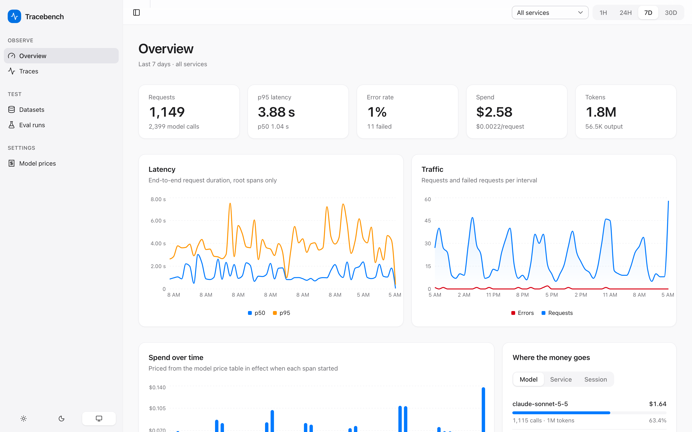
</picture>

</div>

---

## Why this exists

LLM apps break quietly. A prompt edit, a model swap or a tool timeout rarely throws an exception. Instead, answers get shorter, a refund amount disappears, or the bill doubles. Two things are needed to catch that:

1. **See what happened** in production: every model call, tool call and retrieval step, with its tokens, cost and latency. You also need this in a format your existing telemetry already speaks.
2. **Prove it still works** before the next deploy: replay real conversations against the new build and fail the pull request if any of them got worse.

Most teams buy one tool for each, and the two never share data. Tracebench does both from the same spans. It speaks plain OTLP and the [OpenTelemetry GenAI semantic conventions](https://opentelemetry.io/docs/specs/semconv/gen-ai/), so any OTel SDK or GenAI instrumentation can send it data without a vendor SDK. A trace you are looking at in the dashboard is one click away from being a test case.

## Highlights

| | |
| --- | --- |
| **OTLP/HTTP ingest** | `POST /v1/traces` accepts protobuf or JSON, gzip or not. Spans map to typed Pydantic `SpanRecord`s using the current GenAI semconv plus the older attribute names (`gen_ai.system`, `prompt_tokens`, content events) that many instrumentations still emit. Errors come back as `google.rpc.Status`, as the OTLP spec requires. |
| **Built for throughput** | Protobuf decoding runs off the event loop. An in-memory batcher combines many small exports into large ClickHouse inserts, flushing by size or by interval, retrying with backoff and draining on shutdown. A full buffer returns `503` with `Retry-After`, which OTel exporters already know how to back off from. |
| **Columnar storage** | ClickHouse `MergeTree` ordered by `(service_name, start_time, trace_id)` with daily partitions, TTL and ZSTD codecs. Four materialized views keep trace summaries, per-minute latency t-digests, an hourly tool-failure rollup and a time index up to date as spans are inserted. |
| **Trace waterfall** | Collapsible span tree with a timing waterfall that you can drive from the keyboard. An inspector shows prompts, completions, system instructions, tool arguments and results, finish reasons and exception events. |
| **Cost accounting** | A versioned model price table with exact and longest-prefix matching and separate rates for cache reads and writes. Each span is priced with the version in effect when it *started*, so a price change never rewrites history. |
| **Aggregates** | p50/p95 latency, traffic and errors, spend over time, cost broken down by model, service or session, a model latency table and a tool-failure heatmap, over 1H/24H/7D/30D windows. |
| **Promote to dataset** | One click turns a trace's input and output into a golden case. Datasets are versioned: every edit creates a new revision, so any old version, and any eval run pinned to it, can be reproduced exactly. |
| **Pluggable scorers** | Exact match, JSON-schema validity, embedding similarity (fastembed `bge-small`, with a hashing fallback) and an LLM judge (Claude, or a deterministic offline judge). All of them implement one `Scorer` protocol. |
| **Run diff** | Side-by-side comparison of two runs. Each case is labeled regressed, fixed, unchanged, added or removed, with per-scorer score deltas and a word-level diff of the outputs. |
| **CLI and GitHub Action** | `tracebench eval run` replays a dataset against your app, scores it, records the run and compares it with the baseline. It exits `0` when the gate passes, `1` on a regression and `2` on a setup error. The composite Action also posts a summary comment on the PR and updates it on later runs. |

## Screenshots

**Trace waterfall.** Nested agent, LLM and tool spans, with an inspector that shows tokens, cache usage, the price version and the finish reason.

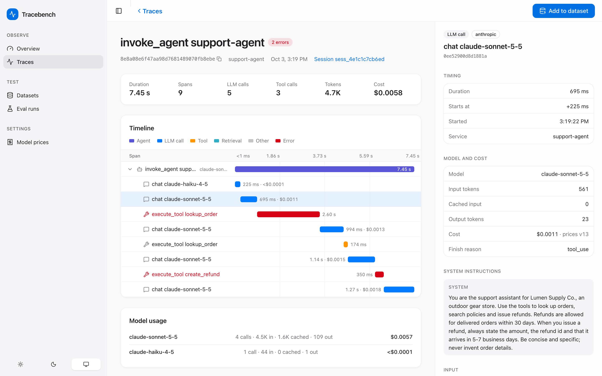

**Tool failures.** Arguments, result and the exception event of a timed-out `lookup_order` call that the agent then retried.

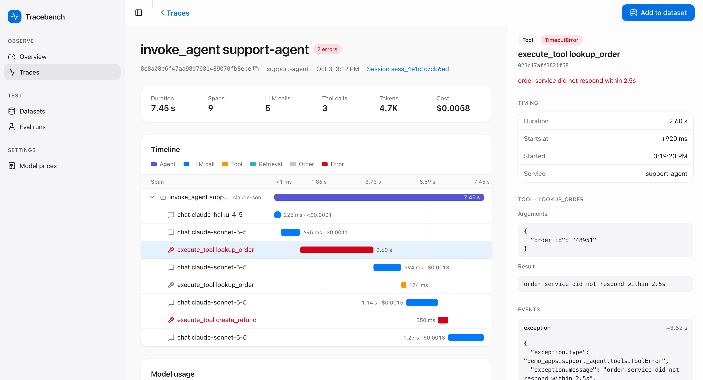

**Run diff.** A PR run that failed the gate against the nightly baseline, with regressions first, word-level diffs and score deltas.

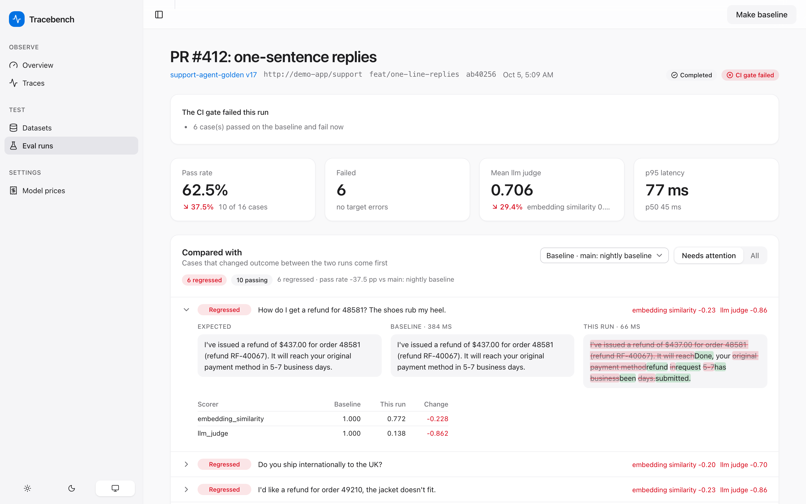

**Eval runs.** Every replay from CI or the dashboard, with its branch, pass rate and the baseline it was judged against.

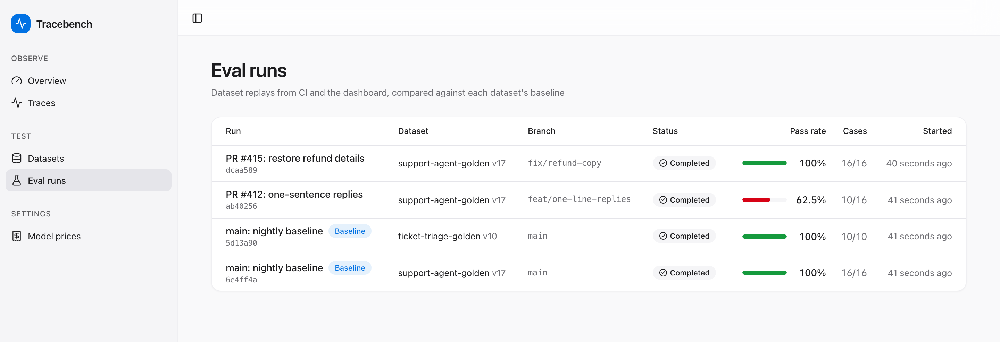

**Tool health and models.** A failure-rate heatmap from the hourly rollup, and p50/p95 latency and spend for each model.

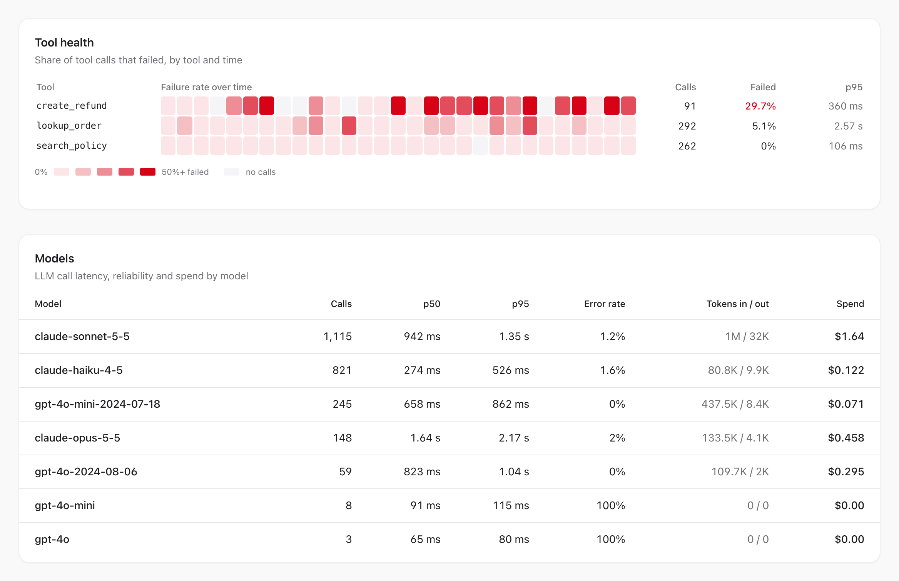

**Traces.** Filter by time window, service, model, status, session or name, with cursor pagination.

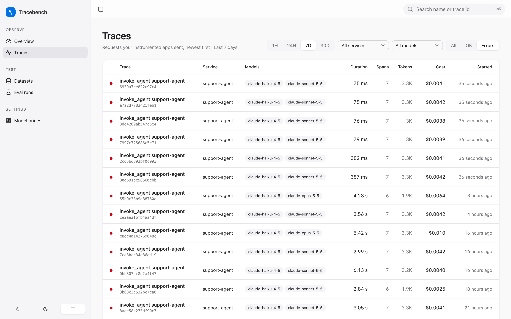

**Promote.** One click turns a production trace's input and output into a regression case.

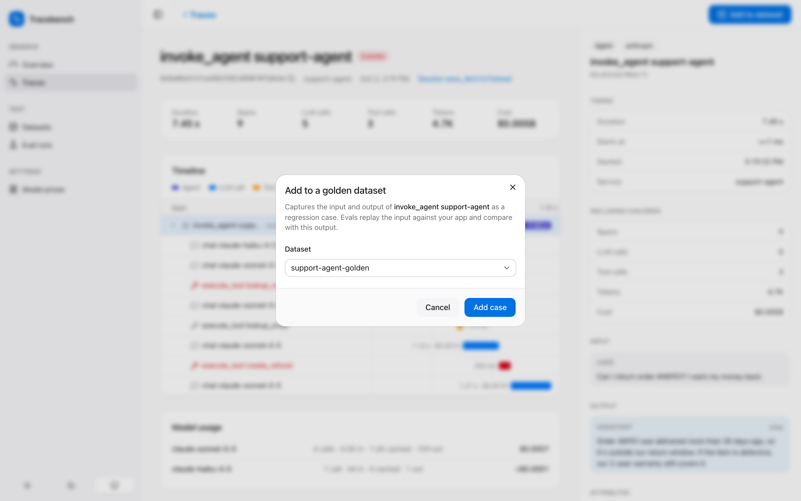

**Golden dataset.** Each case links back to its source trace and shows the version it appeared in.

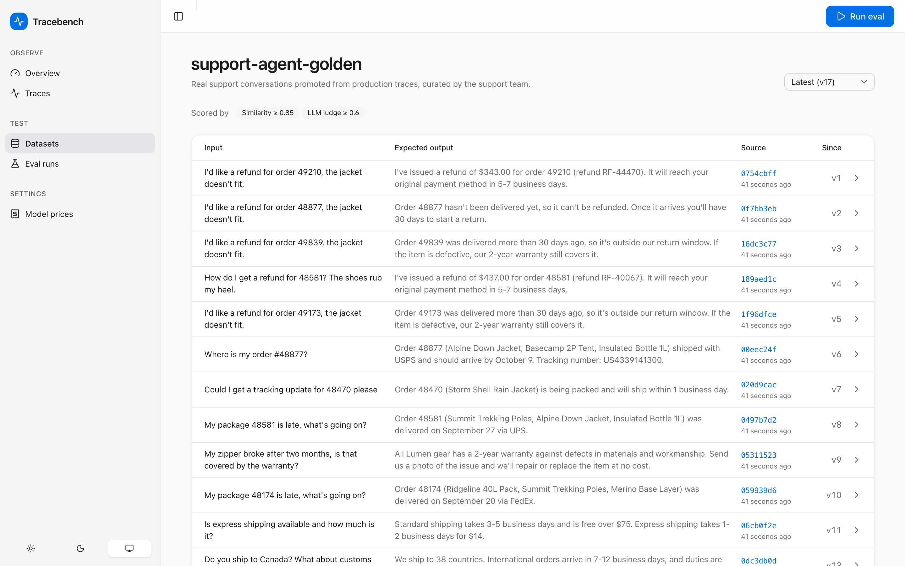

**Price versions.** Per-million-token rates for input, cached input, cache writes and output; spans are priced with the version in effect when they started.

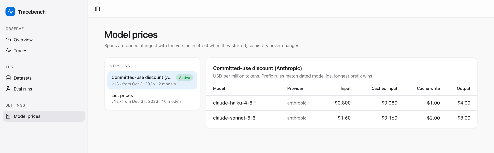

## Architecture

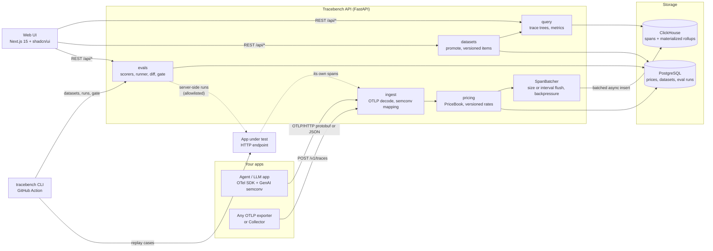

The backend packages map directly onto that diagram:

| Package | Responsibility |
| --- | --- |
| `ingest` | OTLP decoding with size, gzip and nesting limits. Maps semconv attributes into `SpanRecord`. Holds the `SpanBatcher`. |
| `pricing` | `PriceBook`, an immutable, time-aware view over the price versions, refreshed from Postgres in the background. Applied to each span at ingest. |
| `store` | ClickHouse span repository and DDL. SQLAlchemy 2.0 async repositories for prices, datasets, dataset items, eval runs and results. |
| `query` | Assembles the trace tree with rollups and parses chat messages. Runs metric queries against the rollup tables. |
| `datasets` | Extracts a replayable case from a trace. Versioned dataset items. |
| `evals` | `Scorer` protocol and implementations, embedder and judge backends, the concurrent runner, run diff, gate policy and an SSRF-safe target policy. |
| `api` | Routers, bearer-token auth, and error handlers that map domain errors to HTTP and OTLP status codes. |
| `cli` | Typer app, regression orchestration, and Markdown and JSON reports for CI. |

### Ingest path

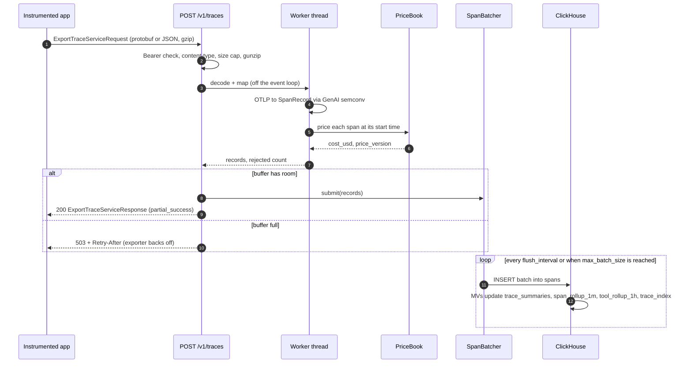

### Regression gate

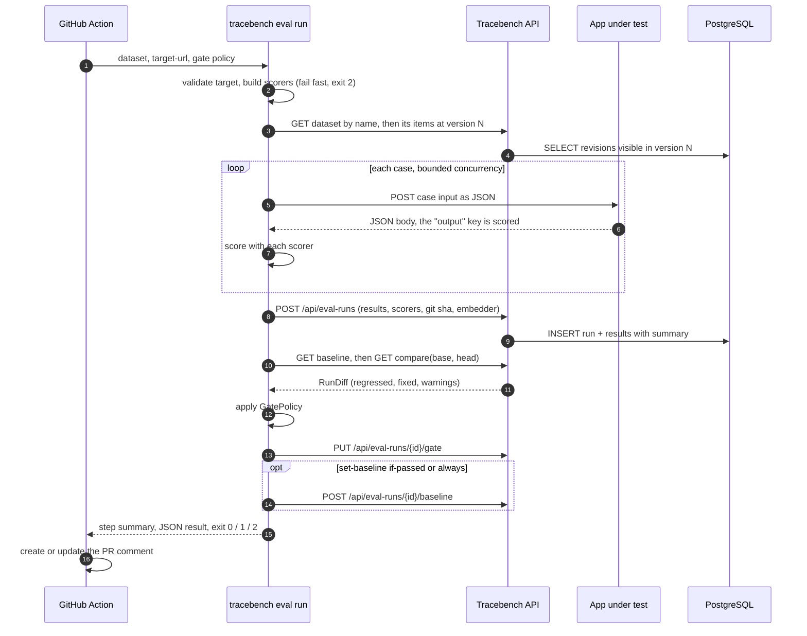

### User flow

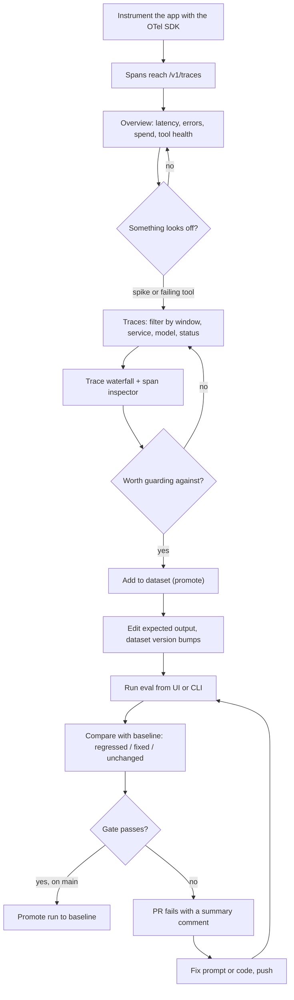

### Data model

Spans live in ClickHouse. Everything that is curated or must stay transactional lives in Postgres.

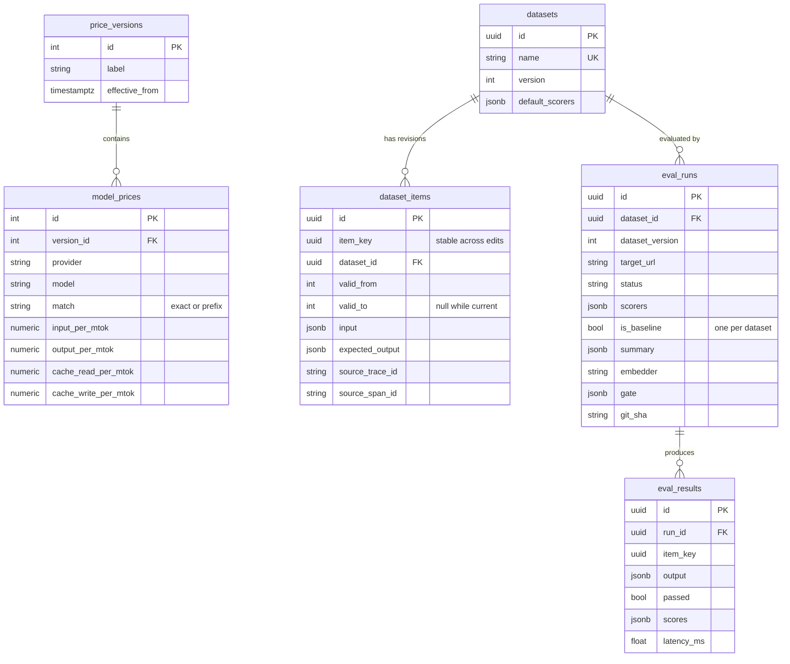

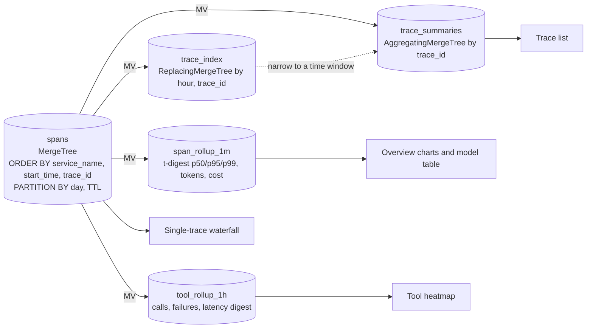

## Tech stack

| Layer | Choice | Why |
| --- | --- | --- |
| API | Python 3.12, FastAPI, Pydantic v2, pydantic-settings | Typed request, response and domain models end to end. Async I/O for ingest and eval fan-out. |
| Telemetry | `opentelemetry-proto`, OpenTelemetry SDK, OTLP/HTTP exporter | The wire format and semantic conventions are open standards, so no client SDK lock-in. |
| Span store | ClickHouse (`clickhouse-connect` async) | Columnar scans, compression and materialized rollups suit append-only, analytics-heavy span data. |
| Metadata | PostgreSQL 16, SQLAlchemy 2.0 async, asyncpg, Alembic | Transactions, unique and partial indexes, and row locks for datasets, baselines and price versions. |
| Evals | fastembed (`BAAI/bge-small-en-v1.5`), Anthropic SDK, jsonschema | Local embeddings with no API key. An optional LLM judge with an offline fallback. |
| CLI and CI | Typer, Rich, composite GitHub Action | One binary for local runs and CI, with exit codes meant for gating. |
| Web | Next.js 15 App Router, TypeScript (strict), shadcn/ui, Tailwind v4, Recharts, TanStack Query, Zod | Data-dense dashboard UI. Response contracts are validated with Zod against fixtures serialized from the Pydantic models. |
| Quality | ruff, mypy `--strict`, pytest (unit + integration), ESLint, Vitest + Testing Library | Every check runs in CI on each push. |
| Packaging | Docker Compose, plus a no-Docker local script | `docker compose up`, or local ClickHouse and Postgres binaries with state kept in `.local/`. |

## Engineering decisions and trade-offs

<details open>
<summary><b>ClickHouse for spans, Postgres for everything else</b></summary>

Spans are append-only, high-volume and read through scans and aggregates, which is the workload columnar storage is built for. Datasets, baselines and price versions need transactions and constraints. Examples: a partial unique index allows only one baseline per dataset, and `SELECT … FOR UPDATE` serializes baseline flips and concurrent promotes. Splitting the two means two databases to run, but neither one is used for a workload it handles badly.
</details>

<details>
<summary><b>Sort key and rollups follow the dashboard's queries</b></summary>

`spans` is ordered by `(service_name, start_time, trace_id)`, so "one service, one time window" reads a contiguous range. A bloom-filter index on `trace_id` serves single-trace lookups. Dashboards never scan raw spans: per-minute t-digest states (`quantilesTDigestState`) merge into p50/p95/p99 for any window, and tool failures are pre-counted per hour. The trace list first narrows to a time window through `trace_index`, ordered by `(start_hour, trace_id)`, before grouping `trace_summaries`. On an empty window this cut rows read from the whole table to zero.
</details>

<details>
<summary><b>Batching with explicit backpressure, at-least-once delivery</b></summary>

ClickHouse prefers a few large inserts to many small ones, because each insert creates a part that has to be merged later. The batcher buffers spans up to `TRACEBENCH_INGEST_MAX_PENDING_SPANS`, flushes when a batch fills or the interval passes, and retries with exponential backoff. When the buffer is full, ingest returns `503 Retry-After` instead of growing memory without bound. On shutdown the batcher drains instead of cancelling, and a batch whose flush is cancelled goes back on the queue. Delivery is therefore at-least-once, and trace reads dedupe by `span_id`.
</details>

<details>
<summary><b>Cost is computed at ingest and stamped with its price version</b></summary>

Pricing at ingest keeps queries cheap and makes historical cost immutable: each span stores `cost_usd` and `price_version`. Versions are deltas, so a "committed-use discount" version only needs to list the discounted models. Lookups prefer an exact model match, then the longest matching prefix, so dated model ids such as `gpt-4o-2024-08-06` resolve without listing every snapshot. A span that arrives before its price is configured keeps a zero cost until it is re-ingested. That is the price of immutability.
</details>

<details>
<summary><b>Dataset items are immutable revisions</b></summary>

Each item revision is visible in versions `[valid_from, valid_to)`. Editing an item closes the current revision and opens a new one. An eval run records the `dataset_version` it used, so a run from last month can be reproduced exactly and diffs can warn when two runs used different versions.
</details>

<details>
<summary><b>An honest regression gate</b></summary>

- A case that no scorer applies to fails as `unscored`. It never passes by default.
- The CLI builds every scorer before making any network call. A bad JSON schema or a missing Anthropic key exits `2` (setup error) instead of `1` (regression).
- Runs record which embedder produced their similarity scores. If the fastembed model could not load and the hashing fallback was used, the diff warns that the scores are not comparable.
- The gate's verdict and policy are stored on the run, so the UI shows exactly what CI decided.
</details>

<details>
<summary><b>Server-side eval runs cannot be used for SSRF</b></summary>

The dashboard can execute runs from the API process, which turns the API into an HTTP client. Targets must match `TRACEBENCH_EVAL_TARGET_ALLOWLIST`. With an empty allowlist, development allows only loopback and production disables server-side runs. Tracebench's own ClickHouse and Postgres addresses are always blocked, redirects are never followed, and error bodies are not reflected back. The CLI is not affected by any of this, because it runs with the caller's own network access.
</details>

<details>
<summary><b>Standards over SDKs</b></summary>

No Tracebench client library exists. The examples use the stock OTel SDK with GenAI semconv attributes, so the same spans could go to any OTLP backend, and any GenAI instrumentation library can send to Tracebench. The mapper also accepts the older attribute names, because real-world instrumentation lags the spec.
</details>

## Quickstart

### Local, no Docker

Requires Python 3.12+, Node 20+ with pnpm 9, and PostgreSQL 16+ binaries (`initdb`, `pg_ctl`). `make services` downloads a pinned, checksum-verified ClickHouse binary on first run.

```bash
make install     # venv in backend/.venv, editable backend + examples, web deps
make services    # ClickHouse on :27105 and Postgres on :5505, all state in .local/
make migrate     # Alembic migrations

make api         # API on http://localhost:8105   (OTLP endpoint: /v1/traces, docs: /docs)
make web         # UI  on http://localhost:3105
make demo-app    # instrumented demo apps on :6405 (the eval target)

make seed        # a week of realistic traffic, two golden datasets, baseline + PR runs
make eval        # run the regression gate against the demo app
```

Stop everything with `make services-stop`. Run `make help` to list all targets.

If your Postgres binaries are not in `/opt/homebrew/opt/postgresql@17/bin`, set `PG_BIN=/path/to/bin`.

### Docker Compose

```bash
cp .env.example .env              # set CLICKHOUSE_PASSWORD and POSTGRES_PASSWORD
docker compose up --build -d      # clickhouse, postgres, api (runs migrations), demo-app, web
docker compose run --rm seed      # optional demo data
```

All ports are bound to `127.0.0.1`. Put a TLS reverse proxy in front of `api` and `web` before you expose them.

## Instrument your app

Any OpenTelemetry SDK works. Point the OTLP/HTTP exporter at Tracebench and record GenAI attributes:

```python
from opentelemetry import trace
from opentelemetry.exporter.otlp.proto.http.trace_exporter import OTLPSpanExporter
from opentelemetry.sdk.resources import Resource
from opentelemetry.sdk.trace import TracerProvider
from opentelemetry.sdk.trace.export import BatchSpanProcessor

provider = TracerProvider(resource=Resource.create({"service.name": "support-agent"}))
provider.add_span_processor(BatchSpanProcessor(OTLPSpanExporter(endpoint="http://localhost:8105/v1/traces")))
tracer = provider.get_tracer("my-app")

with tracer.start_as_current_span("chat claude-sonnet-5-5") as span:
    span.set_attributes({
        "gen_ai.operation.name": "chat",
        "gen_ai.provider.name": "anthropic",
        "gen_ai.request.model": "claude-sonnet-5-5",
    })
    response = client.messages.create(...)
    span.set_attributes({
        "gen_ai.response.model": response.model,
        "gen_ai.usage.input_tokens": response.usage.input_tokens,
        "gen_ai.usage.output_tokens": response.usage.output_tokens,
    })
```

Tool spans use `gen_ai.operation.name = "execute_tool"` with `gen_ai.tool.name`, `gen_ai.tool.call.arguments` and `gen_ai.tool.call.result`. Content (`gen_ai.input.messages`, `gen_ai.output.messages`, `gen_ai.system_instructions`) is optional. Without it you still get timing, tokens and cost, but you cannot promote the trace to a dataset.

The `examples/` package has two complete, runnable patterns:

- **`support_agent`**: a tool-using agent on the raw Anthropic SDK. A cheap router call is followed by a tool loop (`lookup_order`, `search_policy`, `create_refund`) with retries and nested spans. Try `python -m demo_apps.support_agent "Where is my order 48137?"`.
- **`ticket_triage`**: the minimal pattern, one structured-output call with a single CLIENT span.

Both run against a deterministic mock by default. Set `DEMO_PROVIDER=anthropic` and `ANTHROPIC_API_KEY` to call Claude for real. The seeder (`python -m demo_apps.seed`) runs the same instrumented code against a virtual clock to backfill a week of traffic. It also adds a synthetic RAG service (`docs-qa`: embed, retrieve, generate) on a second provider.

## Gate pull requests in CI

```yaml
# .github/workflows/llm-regression.yml
on: pull_request
jobs:
  regression:
    runs-on: ubuntu-latest
    steps:
      - uses: actions/checkout@v4
      # start your app so the runner can reach it, then:
      - uses: <owner>/tracebench@main
        with:
          dataset: support-agent-golden
          target-url: http://localhost:6405/support
          api-url: ${{ vars.TRACEBENCH_API_URL }}
          api-token: ${{ secrets.TRACEBENCH_API_TOKEN }}
          ui-url: ${{ vars.TRACEBENCH_UI_URL }}
          max-pass-rate-drop: "0.05"
          set-baseline: ${{ github.ref == 'refs/heads/main' && 'if-passed' || 'never' }}
```

The Action outputs `passed`, `run-id` and `pass-rate`. It writes a Markdown summary to the job page and keeps one PR comment up to date, found by a hidden marker. Commenting is `continue-on-error`, so the read-only token on a fork PR cannot hide the verdict. This repository's own [`ci.yml`](.github/workflows/ci.yml) uses the Action to gate itself against the demo app.

The same gate from a terminal:

```text
$ tracebench eval run support-agent-golden --target http://localhost:6405/support
  pass  d56953c8    120ms
  pass  0a1a3c65    367ms
  ...
support-agent-golden v17
┏━━━━━━━━━━━━━━━━━━━━━━┳━━━━━━━━━━┳━━━━━━━━━━┓
┃ metric               ┃ this run ┃ baseline ┃
┡━━━━━━━━━━━━━━━━━━━━━━╇━━━━━━━━━━╇━━━━━━━━━━┩
│ pass rate            │   100.0% │   100.0% │
│ llm_judge            │    1.000 │    1.000 │
│ embedding_similarity │    1.000 │    1.000 │
└──────────────────────┴──────────┴──────────┘
diff vs baseline: unchanged_pass 16
regression gate passed
```

<details>
<summary>CLI reference</summary>

| Command | Purpose |
| --- | --- |
| `tracebench eval run DATASET --target URL` | Replay, score, record, compare and gate. Options: `--scorer exact_match \| embedding_similarity[:t] \| llm_judge[:t] \| json_schema:@file`, `--scorers-file`, `--baseline auto\|none\|<run-id>`, `--set-baseline never\|if-passed\|always`, `--min-pass-rate`, `--max-pass-rate-drop`, `--allow-regressions`, `--dataset-version`, `--concurrency`, `--timeout`, `--summary-file`, `--json-output`, `--embeddings`, `--judge`. |
| `tracebench datasets list` | List datasets with version and item count. |
| `tracebench datasets export NAME [--version N] [-o FILE]` | Export a dataset version as JSON lines. |
| `tracebench datasets import NAME FILE` | Append items from a JSON lines file, creating the dataset if it is missing. Items are sent in chunks of 1000. |
| `tracebench runs compare BASE HEAD` | Print the diff between two runs. |
| `tracebench runs set-baseline RUN_ID` | Make a run the dataset baseline. |

Exit codes: `0` gate passed, `1` regression, `2` setup or infrastructure error.
</details>

## Configuration

Every setting has a working local default. See [`.env.example`](.env.example) for the full list.

| Variable | Default | Description |
| --- | --- | --- |
| `TRACEBENCH_ENV` | `development` | `development`, `test` or `production`. Changes the default eval-target policy. |
| `TRACEBENCH_DATABASE_URL` | `postgresql+asyncpg://tracebench@127.0.0.1:5505/tracebench` | Postgres DSN. |
| `TRACEBENCH_CLICKHOUSE_HOST` / `_PORT` | `127.0.0.1` / `27105` | ClickHouse HTTP interface. |
| `TRACEBENCH_CLICKHOUSE_USER` / `_PASSWORD` / `_DATABASE` | `tracebench` | ClickHouse credentials and database. |
| `TRACEBENCH_SPAN_TTL_DAYS` | `30` | Raw span retention. Rollups keep 3x as long. |
| `TRACEBENCH_INGEST_MAX_BATCH_SIZE` | `5000` | Flush when this many spans are buffered. |
| `TRACEBENCH_INGEST_FLUSH_INTERVAL_SECONDS` | `1.0` | Flush at least this often. |
| `TRACEBENCH_INGEST_MAX_PENDING_SPANS` | `200000` | Buffer cap. Above it, ingest returns `503 Retry-After`. |
| `TRACEBENCH_API_TOKEN` | unset | When set, every POST/PUT/PATCH/DELETE under `/api` needs `Authorization: Bearer <token>`. Reads stay open. |
| `TRACEBENCH_INGEST_TOKEN` | unset | When set, guards `/v1/traces`. Exporters send it via `OTEL_EXPORTER_OTLP_HEADERS=Authorization=Bearer%20<token>`. |
| `TRACEBENCH_EVAL_TARGET_ALLOWLIST` | `[]` | `host` or `host:port` entries for server-side runs. When empty, only loopback is allowed in development and server-side runs are disabled in production. |
| `TRACEBENCH_EMBEDDINGS_BACKEND` | `fastembed` | `fastembed` (downloads about 70 MB once) or `hash` (offline, deterministic). |
| `TRACEBENCH_JUDGE_BACKEND` | `offline` | `offline` (deterministic token-overlap judge) or `anthropic`. |
| `TRACEBENCH_JUDGE_MODEL` / `ANTHROPIC_API_KEY` | `claude-sonnet-5-5` / unset | Used when the judge backend is `anthropic`. |
| `TRACEBENCH_CORS_ORIGINS` | `["http://localhost:3105"]` | Allowed browser origins. |
| `TRACEBENCH_API_URL` / `TRACEBENCH_UI_URL` | `http://localhost:8105` / `:3105` | Used by the CLI for API calls and for links in summaries. |
| `NEXT_PUBLIC_API_URL` | `http://localhost:8105` | API base URL compiled into the web bundle. |
| `DEMO_PROVIDER` | `mock` | `mock` or `anthropic` for the example apps. |
| `CLICKHOUSE_PASSWORD` / `POSTGRES_PASSWORD` | required | Docker Compose only. |

## API overview

Interactive OpenAPI docs are at `http://localhost:8105/docs`.

| Method and path | Description |
| --- | --- |
| `POST /v1/traces` | OTLP/HTTP trace export (protobuf or JSON, optional gzip). |
| `GET /api/health` | ClickHouse and Postgres status, batcher stats, active price version. |
| `GET /api/traces` | Paged trace summaries. Filters: `range` or `from`/`to`, service, model, status, session, `q`. |
| `GET /api/traces/facets` | Services, models, operations and tools seen recently. |
| `GET /api/traces/{trace_id}` | Full span tree with rollups and parsed messages. |
| `POST /api/traces/{trace_id}/promote` | Add the trace (or one of its spans) to a dataset. |
| `GET /api/metrics/overview` · `timeseries` · `models` · `cost` · `tools` | KPI tiles, charts, model table, cost breakdown by model, service or session, tool heatmap. |
| `GET/POST /api/datasets` · `GET/PATCH/DELETE /api/datasets/{id}` · `GET /api/datasets/by-name/{name}` | Dataset CRUD. |
| `GET/POST /api/datasets/{id}/items` · `PATCH/DELETE …/items/{item_key}` | Versioned items. Reads accept `?version=`. |
| `GET/POST /api/eval-runs` · `POST /api/eval-runs/execute` | List and record runs. Run server-side against an allowlisted target. |
| `GET /api/eval-runs/{id}` · `…/results` · `GET /api/eval-runs/compare?base=&head=` | Run detail, case results and diff. |
| `GET /api/eval-runs/baseline?dataset_id=` · `POST …/{id}/baseline` · `PUT …/{id}/gate` | Baseline management and the recorded CI verdict. |
| `GET /api/prices/current` · `GET/POST /api/prices/versions` · `GET …/versions/{id}` | Model price versions. |

```bash
# send a span by hand (OTLP JSON)
curl -s localhost:8105/v1/traces -H 'content-type: application/json' -d '{
  "resourceSpans": [{
    "resource": {"attributes": [{"key": "service.name", "value": {"stringValue": "curl-demo"}}]},
    "scopeSpans": [{"spans": [{
      "traceId": "5b8efff798038103d269b633813fc60c", "spanId": "eee19b7ec3c1b174",
      "name": "chat claude-haiku-4-5", "kind": 3,
      "startTimeUnixNano": "1760000000000000000", "endTimeUnixNano": "1760000000850000000",
      "attributes": [
        {"key": "gen_ai.operation.name", "value": {"stringValue": "chat"}},
        {"key": "gen_ai.request.model", "value": {"stringValue": "claude-haiku-4-5"}},
        {"key": "gen_ai.usage.input_tokens", "value": {"intValue": "420"}},
        {"key": "gen_ai.usage.output_tokens", "value": {"intValue": "64"}}
      ]
    }]}]
  }]
}'
```

## Testing

```bash
make lint        # ruff check + format check, ESLint
make typecheck   # mypy --strict on src, tests and examples; tsc --noEmit
make test        # pytest (unit + integration) and Vitest
make test-unit   # backend tests that need no database
make build       # production Next.js build
make ci          # all of the above
```

- **Backend unit tests** cover OTLP decoding and its limits, semconv mapping, pricing, the batcher (including shutdown and cancellation), tree assembly, metrics, scorers, the runner and diff, the target policy, and CLI exit codes. Router tests go through ASGI transport and need no database. They cover status codes 400, 401, 413, 415 and 503 with `Retry-After`, as well as auth.
- **Integration tests** run against live ClickHouse and Postgres. They cover ingest-to-query round trips, promotion, concurrent baseline flips and promotes, SSRF rejection and recovery of orphaned runs. They need `make services`. In CI they use service containers.
- **Web tests** use Vitest with Testing Library for keyboard navigation in the waterfall. Zod contract tests run against JSON fixtures serialized from the backend's Pydantic models, so a schema drift fails the build.
- **CI** ([`ci.yml`](.github/workflows/ci.yml)) runs three jobs: the backend checks, the web checks, and an end-to-end regression gate. The last job boots the API and demo app, seeds data and runs this repository's own Action against them.

## Project structure

```text
tracebench/
├── backend/
│   ├── src/tracebench/
│   │   ├── api/            # routers, auth, error mapping, API schemas
│   │   ├── ingest/         # OTLP decode, GenAI semconv mapping, SpanBatcher
│   │   ├── pricing/        # PriceBook, default price table, refresh service
│   │   ├── store/
│   │   │   ├── clickhouse/ # DDL + materialized views, span repository
│   │   │   └── postgres/   # SQLAlchemy tables and async repositories
│   │   ├── query/          # trace tree assembly, chat message parsing, metrics
│   │   ├── datasets/       # promote/extract, versioned dataset service
│   │   ├── evals/          # scorers/, embeddings, judges, runner, diff, target policy
│   │   ├── cli/            # Typer app, regression orchestration, reports
│   │   ├── config.py       # pydantic-settings
│   │   ├── container.py    # dependency wiring and lifecycle
│   │   └── main.py         # FastAPI app factory
│   ├── migrations/         # Alembic (0001 schema, 0002 embedder + gate)
│   └── tests/              # unit/ and integration/
├── examples/demo_apps/
│   ├── support_agent/      # tool-using agent, raw Anthropic SDK + OTel
│   ├── ticket_triage/      # single structured-output call
│   ├── seed/               # virtual-clock traffic generator, datasets, eval runs
│   ├── server.py           # HTTP eval target (/support, /triage)
│   └── telemetry.py        # tracer provider + GenAI attribute helpers
├── web/src/
│   ├── app/                # overview, traces, datasets, evals, prices routes
│   ├── components/         # waterfall, inspector, charts, heatmap, diff, shadcn/ui
│   └── lib/                # typed API client, Zod schemas, formatting, word diff
├── scripts/local-services.sh  # ClickHouse + Postgres without Docker
├── action.yml              # composite GitHub Action (regression gate)
├── docker-compose.yml
└── Makefile
```

## Roadmap

- [ ] OTLP/gRPC receiver alongside OTLP/HTTP
- [ ] Re-price historical spans after a price version is added retroactively
- [ ] Sampling and PII redaction rules applied at ingest
- [ ] Alerting on p95, error-rate and spend thresholds per service
- [ ] Dataset items from sub-spans (for example a single tool call) with replay adapters
- [ ] Multi-tenant projects with scoped ingest keys
- [ ] Pairwise LLM-judge mode for comparing two runs without a reference answer

## License

[MIT](LICENSE)
